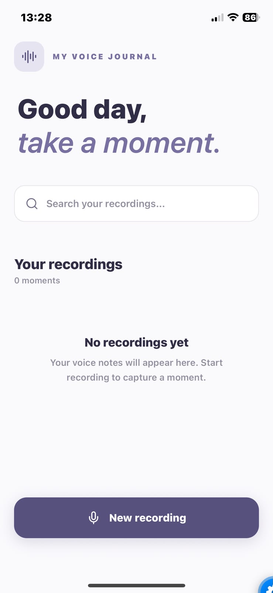
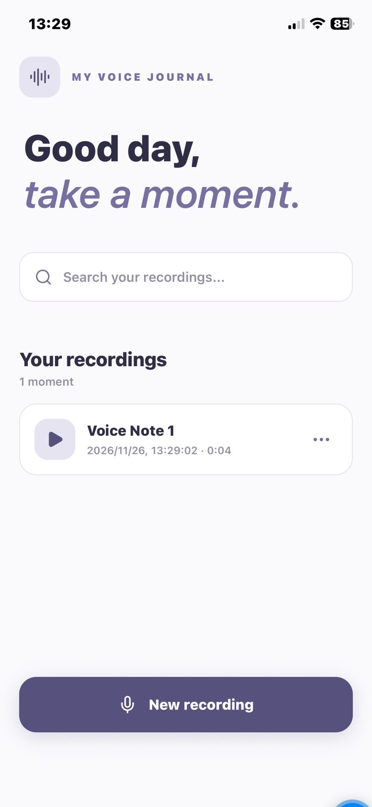
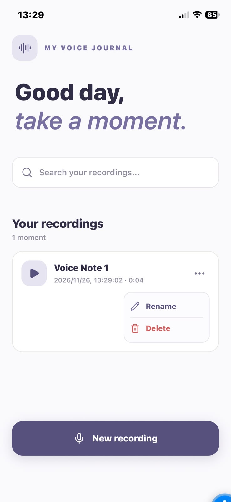
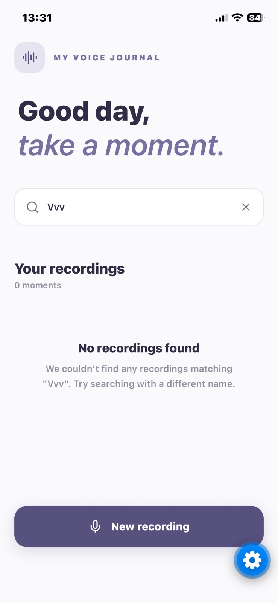

# My Voice Notes – Audio Recorder App

## 1. Project Description

My Voice Notes is a digital voice journal application developed using React Native, Expo and TypeScript.

The application allows users to record, save, play, rename, search and delete voice notes using their mobile devices.

It provides a simple way to capture thoughts, reminders and important moments through audio recordings.

## 2. Main Features

- **Audio Recording:** Record voice notes using the device's microphone.
- **Voice Note List:** Display all saved recordings.
- **Audio Playback:** Play and pause saved recordings.
- **Recording Duration:** Display recording duration and playback progress.
- **Rename Recordings:** Change the names of saved voice notes.
- **Delete Recordings:** Delete unwanted recordings.
- **Search Recordings:** Search for saved recordings by name.
- **Local Storage:** Store recordings on the device.
- **Offline Access:** Access saved recordings without an internet connection.


## Application Screenshots






## To download/Install application 
https://drive.google.com/drive/folders/1pPwcrCAH7LWpxjz9s6PxJcKagvlR_WTD?usp=sharing

or see manual vs app build and installation
## 3. Technologies Used

| Technology | Purpose |
|---|---|
| React Native | Mobile application development |
| Expo | React Native development platform |
| TypeScript | Programming language |
| Expo Audio | Audio recording and playback |
| Expo File System | File management |
| AsyncStorage | Local data storage |
| Lucide React Native | Application icons |
| React Native Safe Area Context | Device safe areas |

## 4. System Requirements

Before installing the project, ensure that you have the following software:

1. **Node.js:** Required to run JavaScript and install project dependencies.
2. **npm:** Used to install the required packages. It is included with Node.js.
3. **Git:** Required to clone the project repository.
4. **Visual Studio Code:** Recommended code editor.
5. **Expo account:** Required when generating an APK using EAS Build.
6. **Android device or emulator:** Used to test the application.

### Download the required software

- Node.js: https://nodejs.org/
- Git: https://git-scm.com/downloads
- Visual Studio Code: https://code.visualstudio.com/
- Expo: https://expo.dev/

After installing Node.js and Git, open a terminal and verify the installations:

```bash
node -v
npm -v
git --version
```

If version numbers appear, the installations were successful.

## 5. Downloading and Cloning the Project

The project is hosted in a GitHub repository. Follow these steps to download a local copy.

### Step 1: Open the GitHub repository

Open the project's GitHub repository in your browser.

Copy the repository URL by clicking the green **Code** button and copying the HTTPS URL.

Example:

```text
https://github.com/Lutricia-The-Coder/AudioRecorder.git
```

Replace the example with the actual repository URL.

### Step 2: Open Visual Studio Code

1. Launch Visual Studio Code.
2. Open the terminal by selecting **Terminal → New Terminal**.
3. Navigate to the folder where you want to save the project.

For example, to save it in Documents:

```bash
cd Documents
```

On Windows, you can also use:

```powershell
cd $HOME\Documents
```

### Step 3: Clone the repository

Enter the following command:

```bash
git clone https://github.com/Lutricia-The-Coder/AudioRecorder.git
```

Replace the URL with your actual GitHub repository URL.

Git will download the project files to your computer.

### Step 4: Enter the project folder

Run:

```bash
cd MyVoiceNotes
```

If the downloaded repository has a different folder name, use that folder name instead.

### Step 5: Open the project in Visual Studio Code

Run:

```bash
code .
```

This opens the cloned project in Visual Studio Code.

If the `code` command is unavailable, open Visual Studio Code manually and select:

**File → Open Folder → MyVoiceNotes**

### Step 6: Install project dependencies

In the VS Code terminal, make sure you are inside the project folder.

Run:

```bash
npm install
```

This installs the packages listed in `package.json`.

If the project does not contain a `package-lock.json` file, npm will generate one.

## 6. Project Structure

The application uses a component-based folder structure to organise the code.

```text
MyVoiceNotes/
│
├── App.tsx
├── app.json
├── package.json
├── eas.json
├── README.md
│
└── src/
    ├── components/
    │   ├── Header.tsx
    │   ├── RecordButton.tsx
    │   ├── SearchBar.tsx
    │   ├── VoiceNoteItem.tsx
    │   ├── VoiceNoteList.tsx
    │   └── RenameModal.tsx
    │
    ├── hooks/
    │   └── useVoiceNotes.ts
    │
    ├── services/
    │   ├── AudioService.ts
    │   └── StorageService.ts
    │
    ├── types/
    │   └── VoiceNote.ts
    │
    └── utils/
        └── formatTime.ts
```

### Folder descriptions

- **components:** Contains the reusable user interface components.
- **hooks:** Contains custom React hooks for managing application functionality.
- **services:** Contains audio and storage-related operations.
- **types:** Contains TypeScript type definitions.
- **utils:** Contains helper functions used throughout the application.

## 7. Installing Dependencies

The project dependencies are normally installed through:

```bash
npm install
```

If you need to install the Expo packages individually, use:

```bash
npx expo install expo-audio expo-file-system @react-native-async-storage/async-storage react-native-safe-area-context react-native-svg
```

Install the icon library:

```bash
npm install lucide-react-native
```

Note: If these packages are already listed in `package.json`, you do not need to install them again individually.

## 8. Running the Application

After installing the dependencies, start the Expo development server:

```bash
npx expo start
```

Expo will display a QR code in the terminal.

You can then:

1. Open the application on a compatible Android device or emulator.
2. Follow the development instructions provided by Expo.
3. Test the application's recording and playback functionality.

Make sure your device and development computer can communicate over the network when using the development server.

## 9. Application Permissions

The application requires microphone permission to record audio.

When prompted, the user must grant microphone access before recording.

The application also uses local device storage to save and manage recorded audio files.

## 10. Building the Android APK

The application can be packaged into an installable Android APK using Expo Application Services (EAS).

### Step 1: Create an Expo account

Visit:

https://expo.dev/signup

Create an account if you do not already have one.

### Step 2: Install EAS CLI

Open the project terminal and run:

```bash
npm install -g eas-cli
```

### Step 3: Log in to Expo

```bash
eas login
```

Enter your Expo account credentials.

### Step 4: Configure EAS Build

Run:

```bash
eas build:configure
```

Follow the prompts to configure the project.

### Step 5: Configure the APK build

Create or open the `eas.json` file in the root folder.

Add the following configuration:

```json
{
  "build": {
    "preview": {
      "android": {
        "buildType": "apk"
      }
    },
    "production": {}
  }
}
```

If the file already contains other configurations, preserve them and add the preview profile.

### Step 6: Generate the APK

Run:

```bash
eas build --platform android --profile preview
```

If Expo asks to generate an Android keystore, allow Expo to manage it unless you already have a keystore you intend to use.

The application will be built using Expo's cloud build service.

### Step 7: Download and install the APK

After the build completes:

1. Open the build link provided by Expo.
2. Download the generated APK.
3. Transfer the APK to your Android device if necessary.
4. Open the APK file on your device.
5. Allow installation from that source if Android requests it.
6. Complete the installation.
7. Open My Voice Notes.


## 10. Project Objective

The objective of My Voice Notes is to develop a simple and user-friendly mobile voice recording application that enables users to capture, organise, search, play and manage personal audio recordings.

The project demonstrates the practical use of React Native, TypeScript, audio recording, local storage and mobile application development.

---

**Project Name:** My Voice Notes – Audio Recorder

**Platform:** Android

**Framework:** React Native with Expo

**Programming Language:** TypeScript

**Build Service:** Expo Application Services (EAS)
